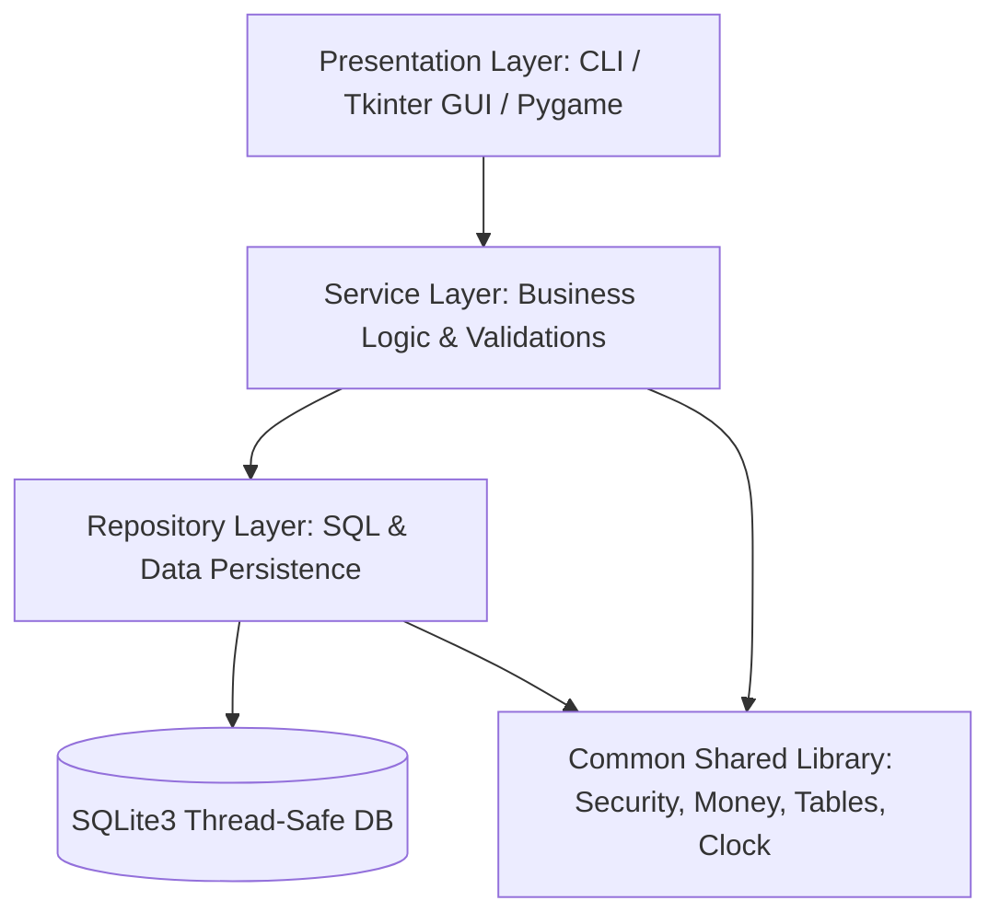

# 🐍 Python Mini Projects Portfolio

[](https://www.python.org/)
[](./industry_projects/tests)
[](https://docs.astral.sh/ruff/)
[](http://mypy-lang.org/)
[](./LICENSE)

A curated collection of **13 real-world Python mini-projects** built with clean code principles, robust software engineering practices, and production-grade architectures.

This repository is organized into two complementary editions:
1. **`industry_projects/`** — Production-grade, layered enterprise architecture (Service-Repository pattern, shared common utilities, strict type safety, 121 unit tests, and CLI/Tkinter/Pygame interfaces).
2. **`python_intermediate_project/`** — Rapid prototype edition with standalone scripts and a unified **Tkinter Visual Dashboard Launcher** for instant execution.

---

## 📑 Table of Contents

- [Project Catalog](#-project-catalog)
- [Repository Structure](#-repository-structure)
- [Architecture & Design Principles](#-architecture--design-principles)
- [Quick Start Guide](#-quick-start-guide)
  - [Prerequisites](#prerequisites)
  - [Industry Projects (CLI, GUI & Test Suite)](#1-industry-projects-modular--tested)
  - [Intermediate Rapid Prototypes (Launcher Dashboard)](#2-intermediate-rapid-prototypes--visual-launcher)
- [Project-by-Project Overview](#-project-by-project-overview)
- [Testing & Quality Assurance](#-testing--quality-assurance)
- [Common Utilities Module](#-common-utilities-module)
- [Contributing](#-contributing)
- [License](#-license)

---

## 🚀 Project Catalog

| # | Project | Domain | Key Highlights | Interfaces | Tests |
|---|---|---|---|---|:---:|
| **01** | [Contact Management](#p01-contact-management-system) | Productivity | CSV import/export, formula injection protection, duplicate checking | CLI, Tkinter GUI | 8 |
| **02** | [Bank Management](#p02-bank-management-system) | Fintech | Double-entry ledger, atomic transactions, PIN hashing, statement generation | CLI | 8 |
| **03** | [ATM Management](#p03-atm-management-system) | Fintech | Card session lifecycle, PIN authentication lockout, denomination dispenser | CLI | 7 |
| **04** | [Library Management](#p04-library-management-system) | Management | Book catalog, borrowing/return lifecycle, overdue fine engine | CLI, Tkinter GUI | 10 |
| **05** | [Hospital Management](#p05-hospital-management-system) | Healthcare | Patient triage, doctor scheduling, appointment clash detection | CLI | 5 |
| **06** | [Bus Reservation](#p06-bus-ticket-reservation-system) | Travel | Interactive seat grid layout, booking engine, dynamic refunds | CLI | 6 |
| **07** | [Airport Management](#p07-airport-management-system) | Aviation | Flight dispatch board, gate allocation, passenger manifest check-in | CLI | 6 |
| **08** | [Zoo Management](#p08-zoo-management-system) | Operations | Enclosure capacity tracking, veterinary diet logs, visitor tickets | CLI | 6 |
| **09** | [Electricity Billing](#p09-electricity-bill-calculator) | Utilities | Progressive tiered tariff slabs, meter log, bill ledger | CLI, Tkinter GUI | 6 |
| **10** | [Exam Seating System](#p10-exam-seating-arrangement-system) | Education | Anti-cheat interleaved student distribution, hall grid visualizer | CLI | 7 |
| **11** | [Snake Game](#p11-classic-snake-game) | Gaming | Pygame 60 FPS engine, food spawns, collision physics, high-scores | Pygame Window | 9 |
| **12** | [Website Blocker](#p12-website-blocker) | System / Tool | Safe hosts file manipulation, dry-run mode, scheduled distraction blocking | CLI / Daemon | 6 |
| **13** | [Image Downloader](#p13-parallel-image-downloader) | Networking | Multi-threaded worker pool (`ThreadPoolExecutor`), streaming chunks, retries | CLI | 15 |

---

## 📂 Repository Structure

```text
Python-mini_projects/
├── industry_projects/              # Enterprise / Production-Grade Modular Codebase
│   ├── Makefile                    # Single-entry automation (setup, test, lint, run)
│   ├── pyproject.toml              # Ruff and Mypy configuration
│   ├── pytest.ini                  # Pytest test-runner configuration
│   ├── requirements.txt            # Core runtime dependencies (Pygame, Pillow)
│   ├── requirements-dev.txt        # Development dependencies (pytest, ruff, mypy)
│   ├── requirements-online.txt     # Optional network libraries (requests)
│   ├── LICENSE                     # MIT Open-Source License
│   ├── common/                     # Reusable foundational infrastructure
│   │   ├── clock.py                # Deterministic virtual clock for unit testing
│   │   ├── db.py                   # Thread-safe SQLite context managers & WAL mode
│   │   ├── input_helpers.py        # Safe terminal prompt validators & menu builder
│   │   ├── money.py                # Currency representation avoiding float rounding
│   │   ├── security.py             # PBKDF2/SHA-256 PIN hashing & CSV sanitization
│   │   └── tables.py               # Dynamic ASCII tabular formatter
│   ├── projects/                   # 13 Modular Applications
│   │   ├── p01_contact_management/
│   │   ├── p02_bank_management/
│   │   ├── p03_atm_management/
│   │   ├── p04_library_management/
│   │   ├── p05_hospital_management/
│   │   ├── p06_bus_reservation/
│   │   ├── p07_airport_management/
│   │   ├── p08_zoo_management/
│   │   ├── p09_electricity_bill/
│   │   ├── p10_exam_seating/
│   │   ├── p11_snake_game/
│   │   ├── p12_website_blocker/
│   │   └── p13_image_downloader/
│   └── tests/                      # 121 Comprehensive Pytest Unit & Integration Tests
│
├── python_intermediate_project/    # Rapid Prototype Edition & Visual Launcher
│   ├── launcher.py                 # Tkinter GUI Control Center for all 13 apps
│   ├── test_logic.py               # Smoke testing suite for standalone scripts
│   ├── test_gui.py                 # GUI verification harness
│   ├── common.py                   # Lightweight helpers for prototypes
│   ├── data/                       # Pre-seeded SQLite sample databases
│   └── *.py                        # Individual standalone project scripts
│
├── .gitignore                      # Git exclusion rules
└── README.md                       # Repository master documentation
```

---

## 🏛 Architecture & Design Principles

The modular edition (`industry_projects/`) follows industry best practices:



1. **Separation of Concerns (Layered MVC/Service-Repository)**:
   - **`models.py`**: Immutable dataclasses representing business domain entities.
   - **`repository.py`**: Encapsulates raw SQL queries, transactions, and row mappings.
   - **`service.py`**: Business rules, calculation logic, security checks, and input validations.
   - **`cli.py` / `gui_app.py`**: Presentation layer decoupled from database logic.
2. **Safe Database Operations**:
   - Parameterized queries (`?`) everywhere to guarantee zero SQL injection risks.
   - Write-Ahead Logging (`PRAGMA journal_mode=WAL`) and Foreign Key enforcement enabled by default.
3. **Data Integrity & Security**:
   - Zero floating-point arithmetic for currency; all money is handled via fixed-point/integer cents.
   - Password and PIN protection using cryptographic salt and SHA-256 / PBKDF2 with constant-time equality checks.
   - CSV formula injection protection: automatic neutralization of leading `=`, `+`, `-`, or `@` characters.
4. **Deterministic Testing**:
   - Unit tests run against isolated in-memory SQLite instances (`:memory:`) or mocked filesystem paths.
   - Mockable virtual clocks allow testing time-based scenarios (loans, overdue fines, scheduled blocker) without sleep delays.

---

## ⚡ Quick Start Guide

### Prerequisites
- Python 3.11, 3.12, 3.13, or 3.14
- Git
- `make` (optional, for convenient Makefile commands on macOS/Linux)

---

### 1. Industry Projects (Modular & Tested)

#### Step 1: Clone the Repository
```bash
git clone https://github.com/pabitralenka07/Python-mini_projects.git
cd Python-mini_projects/industry_projects
```

#### Step 2: Set Up Virtual Environment & Dependencies
Using `make`:
```bash
make setup
```
Or manually with standard Python commands:
```bash
python3 -m venv .venv
source .venv/bin/activate       # On Windows: .venv\Scripts\activate
pip install -r requirements-dev.txt
```

#### Step 3: Run the Quality Gate & Tests
Ensure everything is working with 121 passing tests:
```bash
make test
# Or: .venv/bin/pytest tests/ -v
```

#### Step 4: Seed Sample Data
Populate realistic demo records into the local databases:
```bash
make seed-all
```

#### Step 5: Launch Any Application
You can launch any project using the unified Makefile commands or directly as Python modules:

```bash
# P01 Contact Management (CLI or Tkinter GUI)
make run-p01
make run-p01-gui

# P02 Bank Management
make run-p02

# P03 ATM Management
make run-p03

# P04 Library Management (CLI or GUI)
make run-p04
make run-p04-gui

# P05 Hospital Management
make run-p05

# P06 Bus Ticket Reservation
make run-p06

# P07 Airport Management
make run-p07

# P08 Zoo Management
make run-p08

# P09 Electricity Billing (CLI or GUI)
make run-p09
make run-p09-gui

# P10 Exam Seating Arrangement
make run-p10

# P11 Classic Snake Game (Pygame Window)
make run-p11

# P12 Website Blocker (Safe Dry-Run by Default)
make run-p12

# P13 Parallel Image Downloader
make run-p13
```

---

### 2. Intermediate Rapid Prototypes & Visual Launcher

If you prefer exploring the standalone scripts or launching any application through a visual dashboard:

```bash
cd python_intermediate_project

# Launch the visual dashboard
python3 launcher.py
```

Clicking any button on the dashboard will instantly launch that application in a dedicated window.

---

## 🔍 Project-by-Project Overview

### P01: Contact Management System
- **Location**: `industry_projects/projects/p01_contact_management`
- **Features**: Complete contact lifecycle (Add, View, Edit, Delete), regex validation for phone numbers and emails, multi-field search engine, safe CSV import/export with formula injection defense, and an optional Level 2 Tkinter GUI.
- **Run**: `python -m projects.p01_contact_management` (CLI) or `python -m projects.p01_contact_management.gui_app` (GUI).

### P02: Bank Management System
- **Location**: `industry_projects/projects/p02_bank_management`
- **Features**: Production-grade banking core supporting customer creation, savings/checking accounts, atomic funds transfer, deposit, withdrawal with overdraft limits, and chronological transaction history.
- **Run**: `python -m projects.p02_bank_management`

### P03: ATM Management System
- **Location**: `industry_projects/projects/p03_atm_management`
- **Features**: Realistic ATM session flow with card number validation, salted PIN authentication with 3-attempt lockout, cash withdrawal powered by a greedy denomination dispenser algorithm ($100, $50, $20, $10), and PIN modification.
- **Run**: `python -m projects.p03_atm_management`

### P04: Library Management System
- **Location**: `industry_projects/projects/p04_library_management`
- **Features**: Book catalog with ISBN tracking, member registration, book borrowing/return tracking, automatic overdue fine calculator, reservation queues, and an interactive Tkinter GUI.
- **Run**: `python -m projects.p04_library_management` (CLI) or `python -m projects.p04_library_management.gui_app` (GUI).

### P05: Hospital Management System
- **Location**: `industry_projects/projects/p05_hospital_management`
- **Features**: Patient triage admissions, doctor scheduling by specialization, appointment booking with clash prevention, prescription records, and itemized billing discharge summaries.
- **Run**: `python -m projects.p05_hospital_management`

### P06: Bus Ticket Reservation System
- **Location**: `industry_projects/projects/p06_bus_reservation`
- **Features**: Terminal-rendered visual seat matrix displaying booked vs. available seats, multi-route selection, passenger booking with seat allocation, and cancellations with configurable refund rules.
- **Run**: `python -m projects.p06_bus_reservation`

### P07: Airport Management System
- **Location**: `industry_projects/projects/p07_airport_management`
- **Features**: Real-time flight schedule tracker (Departures/Arrivals), boarding gate allocation, passenger manifest check-in, seat assignment, and luggage baggage tracking.
- **Run**: `python -m projects.p07_airport_management`

### P08: Zoo Management System
- **Location**: `industry_projects/projects/p08_zoo_management`
- **Features**: Animal registry categorized by species and enclosure, diet & feeding schedules, veterinary health check logs, and visitor ticket sales tracking.
- **Run**: `python -m projects.p08_zoo_management`

### P09: Electricity Bill Calculator
- **Location**: `industry_projects/projects/p09_electricity_bill`
- **Features**: Progressive tariff rate engine calculating tiered consumption slabs (e.g., 0-100 units, 101-300 units, 301+ units), customer meter readings, billing history, payment recording, and Tkinter GUI.
- **Run**: `python -m projects.p09_electricity_bill` (CLI) or `python -m projects.p09_electricity_bill.gui_app` (GUI).

### P10: Exam Seating Arrangement System
- **Location**: `industry_projects/projects/p10_exam_seating`
- **Features**: Hall layout generator, candidate registration, and an anti-cheat seating algorithm that alternates student departments to eliminate adjacent seats of identical courses. Visual grid display.
- **Run**: `python -m projects.p10_exam_seating`

### P11: Classic Snake Game
- **Location**: `industry_projects/projects/p11_snake_game`
- **Features**: Pygame 2D arcade gameplay, 60 FPS smooth rendering, directional queueing to prevent self-collision reversals, apple spawns, progressive speed scaling, and persistent high-score tracking.
- **Run**: `python -m projects.p11_snake_game`

### P12: Website Blocker (Productivity Engine)
- **Location**: `industry_projects/projects/p12_website_blocker`
- **Features**: Operating system hosts file modifier with safety backups, dry-run simulation mode by default (to avoid accidental system changes), schedule-based distraction blocking (e.g., 09:00 - 17:00), and restore mechanisms.
- **Run**: `python -m projects.p12_website_blocker`

### P13: Parallel Image Downloader
- **Location**: `industry_projects/projects/p13_image_downloader`
- **Features**: High-concurrency image fetcher utilizing Python's `concurrent.futures.ThreadPoolExecutor`, chunked byte streaming with SHA-256 hashing, mime-type verification, retry backoff, and progress telemetry.
- **Run**: `python -m projects.p13_image_downloader`

---

## 🧪 Testing & Quality Assurance

The codebase includes an automated test suite with **121 unit and integration tests** testing models, repository transactions, service business logic, error boundaries, and CLI controllers.

```bash
cd industry_projects

# Run test suite
make test

# Run tests with test coverage breakdown
make test-cov

# Run code style & formatting checks with Ruff
make lint

# Run strict type checking with Mypy
make typecheck

# Full CI Quality Gate (Lint + Typecheck + Test)
make check
```

---

## 🛠 Common Utilities Module

All modular projects leverage a shared, robust common library located in `industry_projects/common/`:

- **`common.db`**: Thread-safe SQLite context managers, automatic connection pooling, foreign keys, and WAL configuration.
- **`common.security`**: Secure password/PIN hashing using PBKDF2/SHA-256 with cryptographic salt, constant-time equality checks, and spreadsheet CSV injection neutralizing.
- **`common.money`**: Precise monetary calculations avoiding floating-point rounding errors.
- **`common.clock`**: Mockable clock abstraction for reproducible time-based testing.
- **`common.tables`**: Terminal table renderer with customizable borders, column alignment, and cell truncation.
- **`common.input_helpers`**: Sanitized terminal input handlers with type casting, regex validation, retry prompts, and user cancellation handling.

---

## 🤝 Contributing

Contributions, issues, and feature requests are welcome!
1. Fork the Project
2. Create your Feature Branch (`git checkout -b feature/AmazingFeature`)
3. Commit your Changes (`git commit -m 'Add some AmazingFeature'`)
4. Verify Quality Gate (`make check`)
5. Push to the Branch (`git push origin feature/AmazingFeature`)
6. Open a Pull Request

---

## 📄 License

This repository is licensed under the [MIT License](./LICENSE). Feel free to use these projects for learning, building your portfolio, or extending into full-scale applications.

---

<p align="center">
  <b>Built with ❤️ by <a href="https://github.com/pabitralenka07">Pabitra Lenka</a></b>
</p>
