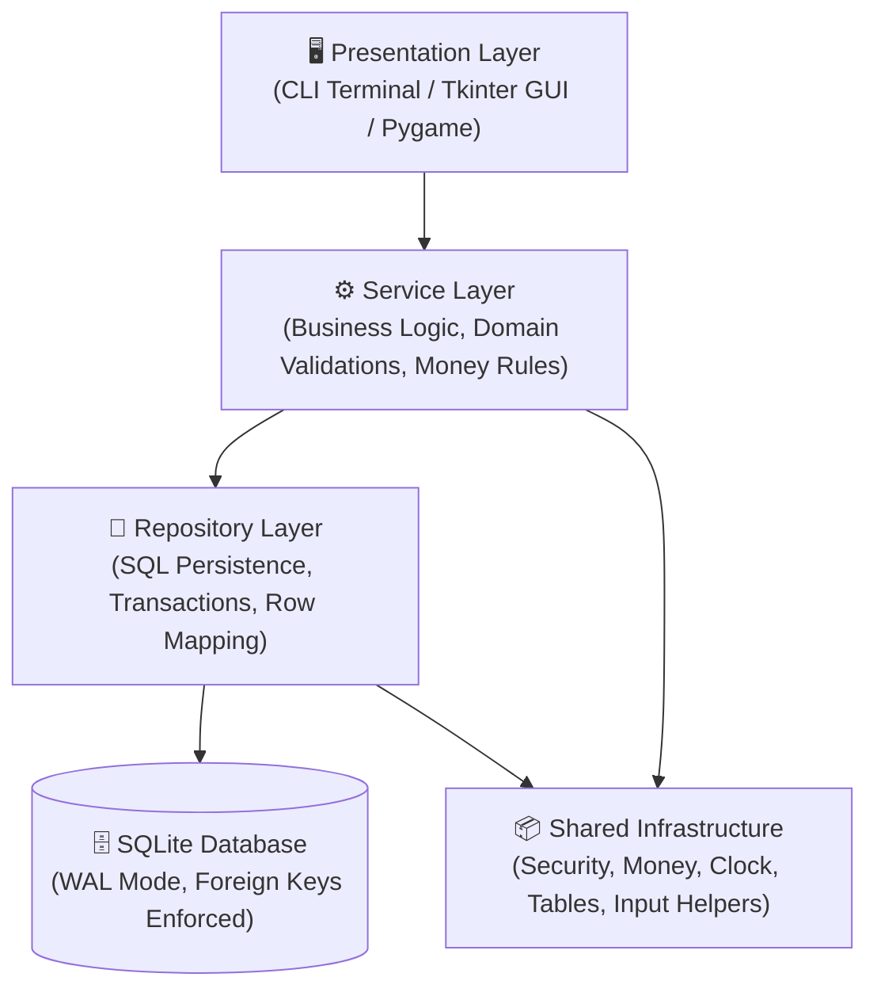

# 🐍 Python Mini Projects Portfolio 🚀

<div align="center">

[](https://www.python.org/)
[](./industry_projects/tests)
[](https://docs.astral.sh/ruff/)
[](http://mypy-lang.org/)
[](./LICENSE)

**A production-grade, dual-edition portfolio of 13 real-world Python mini-projects.**  
*Engineered with clean code principles, the Service-Repository pattern, robust security safeguards, and zero-float monetary math.*

[Explore Projects](#-project-catalog) • [Quick Start](#-quick-start-guide) • [Architecture](#-architecture--design-patterns) • [Testing](#-testing--quality-assurance)

</div>

---

## 🌟 Overview & Key Highlights

This repository offers a comprehensive, dual-track learning and implementation experience:

| Feature / Dimension | 🏢 `industry_projects/` (Enterprise Edition) | ⚡ `python_intermediate_project/` (Rapid Prototype) |
|---|---|---|
| **Primary Focus** | Production-ready software engineering | Immediate prototyping & learning concepts |
| **Architecture** | Layered Service-Repository Pattern (MVC) | Self-contained single-script applications |
| **Type Safety** | Strict Mypy type annotations throughout | Clean, standard Python typing |
| **Testing** | 121 comprehensive Pytest unit & integration tests | Built-in logic & GUI smoke test harnesses |
| **User Interfaces** | Rich Terminal CLIs, Tkinter GUIs, and Pygame | Unified Tkinter Visual Dashboard Launcher |
| **Data Safety** | Safe migrations, WAL mode, corruption recovery | Pre-seeded sample SQLite databases in `data/` |
| **Monetary Math** | Fixed-point integer minor-unit (cents) arithmetic | Integer/decimal based currency logic |

---

## 📑 Table of Contents

- [🌟 Overview & Key Highlights](#-overview--key-highlights)
- [🚀 Project Catalog](#-project-catalog)
- [🏛 Architecture & Design Patterns](#-architecture--design-patterns)
  - [Layered MVC / Service-Repository](#layered-mvc--service-repository)
  - [Shared Enterprise Infrastructure](#shared-enterprise-infrastructure)
  - [Security & Integrity Protections](#security--integrity-protections)
- [📂 Repository Structure](#-repository-structure)
- [⚡ Quick Start Guide](#-quick-start-guide)
  - [1. Industry Edition (CLI, GUI & Test Suite)](#1-industry-projects-enterprise-edition)
  - [2. Intermediate Prototype Edition (Visual Launcher)](#2-intermediate-prototypes--visual-launcher)
- [🔍 Detailed Project Walkthrough](#-detailed-project-walkthrough)
- [🧪 Testing & Quality Assurance](#-testing--quality-assurance)
- [🤝 Contributing](#-contributing)
- [📄 License & Author](#-license--author)

---

## 🚀 Project Catalog

| # | Project | Domain | Key Engineering Features | Interfaces | Unit Tests |
|---|---|---|---|---|:---:|
| **01** | [📇 Contact Management](#p01-contact-management-system) | Productivity | Safe CSV import/export, formula injection neutralizing, regex phone/email validation | CLI, Tkinter GUI | 8 |
| **02** | [🏦 Bank Management](#p02-bank-management-system) | Fintech | Double-entry transaction ledger, atomic funds transfer, salted PIN hashing | CLI | 8 |
| **03** | [🏧 ATM Management](#p03-atm-management-system) | Fintech | Card session state machine, 3-strike PIN lockout, greedy cash denomination dispenser | CLI | 7 |
| **04** | [📚 Library Management](#p04-library-management-system) | Management | Book catalog, borrow/return lifecycle, reservation queue, overdue fine engine | CLI, Tkinter GUI | 10 |
| **05** | [🏥 Hospital Management](#p05-hospital-management-system) | Healthcare | Patient triage status, doctor schedule clash detection, itemized billing | CLI | 5 |
| **06** | [🚌 Bus Ticket Reservation](#p06-bus-ticket-reservation-system) | Travel | 2D terminal seat layout, booking concurrency guards, progressive refund matrix | CLI | 6 |
| **07** | [✈️ Airport Management](#p07-airport-management-system) | Aviation | Flight dispatch board, boarding gate allocation, passenger manifest check-in | CLI | 6 |
| **08** | [🦁 Zoo Management](#p08-zoo-management-system) | Operations | Enclosure capacity validation, dietary feeding schedules, visitor ticket ledger | CLI | 6 |
| **09** | [💡 Electricity Billing](#p09-electricity-bill-calculator) | Utilities | Progressive slab tariff engine, meter log, bill generation & payment ledger | CLI, Tkinter GUI | 6 |
| **10** | [🎓 Exam Seating System](#p10-exam-seating-arrangement-system) | Education | Anti-cheating interleaved student distribution, hall visualizer grid | CLI | 7 |
| **11** | [🐍 Classic Snake Game](#p11-classic-snake-game) | Gaming | Pygame 60 FPS loop, food spawns, collision physics, persistent high scores | Pygame Window | 9 |
| **12** | [🛡️ Website Blocker](#p12-website-blocker) | System Utility | Hosts file parser, atomic write backups, dry-run simulation mode, schedule daemon | CLI / Daemon | 6 |
| **13** | [🖼️ Parallel Image Downloader](#p13-parallel-image-downloader) | Networking | Multi-threaded worker pool (`ThreadPoolExecutor`), streaming chunks, SHA-256 integrity | CLI, Tkinter GUI | 15 |

---

## 🏛 Architecture & Design Patterns

### Layered MVC / Service-Repository

Every application in `industry_projects/` strictly isolates concerns into clean, decoupled layers:



- **`models.py`**: Immutable dataclasses representing domain state and business entities.
- **`repository.py`**: Encapsulates raw SQL queries, parameterized queries (`?`), and context-managed transactions.
- **`service.py`**: Enforces domain constraints, calculations, security rules, and user validation.
- **`cli.py` / `gui_app.py`**: Presentation controllers without raw SQL queries or business rules.

---

### Shared Enterprise Infrastructure

Located in [`industry_projects/common/`](./industry_projects/common/):

- 💰 **`common.money`**: Eliminates IEEE 754 floating-point inaccuracies by storing all monetary amounts as integer cents (`$12.50` = `1250` cents). Handles safe formatting and parsing without float round-off.
- 🔐 **`common.security`**: Educational authentication security featuring `hashlib.scrypt` password/PIN derivation with cryptographically random salts, constant-time `hmac.compare_digest` verification, and temporary lockout tracking.
- 🗄️ **`common.db`**: Thread-safe SQLite context managers enforcing `PRAGMA foreign_keys = ON`, `PRAGMA journal_mode = WAL`, and automated database corruption integrity checking (`PRAGMA quick_check`).
- ⏱️ **`common.clock`**: Mockable, deterministic virtual clock interface enabling lightning-fast unit testing of overdue loans, interest, and scheduled blockers without brittle sleep calls.
- 📊 **`common.tables`**: Terminal ASCII table formatter with dynamic column auto-sizing and text truncation.
- ⌨️ **`common.input_helpers`**: Resilient terminal prompt validators handling type casting, bounds checking, and cancellation.

---

### Security & Integrity Protections

> [!IMPORTANT]
> - **Zero SQL Injection**: 100% of database queries use parameterized SQL placeholders (`?`).
> - **CSV Formula Injection Defense**: Any user-supplied text starting with dangerous spreadsheet formula triggers (`=`, `+`, `-`, `@`, `\t`, `\r`) is automatically neutralized upon export.
> - **Constant-Time Verification**: All secret and PIN checks use `hmac.compare_digest` to mitigate side-channel timing attacks.

---

## 📂 Repository Structure

```text
Python-mini_projects/
├── industry_projects/                  # 🏢 Enterprise Modular Codebase
│   ├── Makefile                        # Single-entry automation (setup, test, lint, run)
│   ├── pyproject.toml                  # Ruff and Mypy strict configuration
│   ├── pytest.ini                      # Pytest runner configuration
│   ├── requirements.txt                # Core runtime dependencies (Pygame, Pillow)
│   ├── requirements-dev.txt            # Development tools (pytest, ruff, mypy)
│   ├── requirements-online.txt         # Optional network dependencies (requests)
│   ├── common/                         # Shared core infrastructure modules
│   │   ├── clock.py                    # Mockable deterministic virtual clock
│   │   ├── db.py                       # Thread-safe SQLite context manager & WAL
│   │   ├── input_helpers.py            # Terminal prompt validators & menu builder
│   │   ├── money.py                    # Fixed-point minor-unit currency arithmetic
│   │   ├── security.py                 # Scrypt hashing, salting & CSV sanitization
│   │   └── tables.py                   # Terminal ASCII table formatter
│   ├── projects/                       # 13 Modular Applications
│   │   ├── p01_contact_management/
│   │   ├── p02_bank_management/
│   │   ├── p03_atm_management/
│   │   ├── p04_library_management/
│   │   ├── p05_hospital_management/
│   │   ├── p06_bus_reservation/
│   │   ├── p07_airport_management/
│   │   ├── p08_zoo_management/
│   │   ├── p09_electricity_bill/
│   │   ├── p10_exam_seating/
│   │   ├── p11_snake_game/
│   │   ├── p12_website_blocker/
│   │   └── p13_image_downloader/
│   └── tests/                          # 121 Passing Pytest Unit & Integration Tests
│
├── python_intermediate_project/        # ⚡ Rapid Prototype Edition & Visual Hub
│   ├── launcher.py                     # Visual Tkinter Dashboard for all 13 apps
│   ├── test_logic.py                   # Fast smoke test suite for standalone scripts
│   ├── test_gui.py                     # Headless GUI verification test harness
│   ├── common.py                       # Lightweight helper utilities
│   ├── data/                           # Pre-seeded sample SQLite databases
│   └── *.py                            # Standalone project scripts
│
├── .gitignore                          # Git exclusion rules
├── LICENSE                             # MIT Open-Source License
└── README.md                           # Master Portfolio Documentation
```

---

## ⚡ Quick Start Guide

### Prerequisites
- **Python**: 3.11, 3.12, 3.13, or 3.14
- **Git**
- **Make** *(optional, for convenient one-line Makefile commands on macOS/Linux)*

---

### 1. Industry Projects (Enterprise Edition)

#### Step 1: Clone the Repository
```bash
git clone https://github.com/pabitralenka07/Python-mini_projects.git
cd Python-mini_projects/industry_projects
```

#### Step 2: Set Up Virtual Environment & Dependencies
Using `make`:
```bash
make setup
```
Or manually using standard Python:
```bash
python3 -m venv .venv
source .venv/bin/activate       # On Windows: .venv\Scripts\activate
pip install -r requirements-dev.txt
```

#### Step 3: Run the Test Suite
Verify that all 121 unit and integration tests pass:
```bash
make test
# Or directly: pytest tests/ -v
```

#### Step 4: Seed Sample Data
Populate demo records across all project databases:
```bash
make seed-all
```

#### Step 5: Launch Any Project
Run projects using either Makefile shortcuts or direct Python module execution:

```bash
# 📇 P01: Contact Management (CLI or GUI)
make run-p01
make run-p01-gui

# 🏦 P02: Bank Management
make run-p02

# 🏧 P03: ATM Management
make run-p03

# 📚 P04: Library Management (CLI or GUI)
make run-p04
make run-p04-gui

# 🏥 P05: Hospital Management
make run-p05

# 🚌 P06: Bus Ticket Reservation
make run-p06

# ✈️ P07: Airport Management
make run-p07

# 🦁 P08: Zoo Management
make run-p08

# 💡 P09: Electricity Billing (CLI or GUI)
make run-p09
make run-p09-gui

# 🎓 P10: Exam Seating Arrangement
make run-p10

# 🐍 P11: Classic Snake Game (Pygame Window)
make run-p11

# 🛡️ P12: Website Blocker (Dry-run mode by default)
make run-p12

# 🖼️ P13: Parallel Image Downloader
make run-p13
```

---

### 2. Intermediate Prototypes & Visual Launcher

To explore standalone scripts or launch everything through a unified visual dashboard:

```bash
cd python_intermediate_project

# Launch the visual dashboard hub
python3 launcher.py
```

Clicking any project on the dashboard launches that application in its own interactive window.

---

## 🔍 Detailed Project Walkthrough

### 📇 P01: Contact Management System
- **Path**: `industry_projects/projects/p01_contact_management`
- **Core Logic**: Contact CRUD operations, regex email and phone validation, multi-column search, and safe CSV export with formula injection neutralization.
- **Run**: `python3 -m industry_projects.projects.p01_contact_management` *(CLI)* or `--gui` *(Tkinter)*.

### 🏦 P02: Bank Management System
- **Path**: `industry_projects/projects/p02_bank_management`
- **Core Logic**: Production banking core with double-entry transaction ledgers, atomic funds transfers, checking account overdraft limits, and chronological statement exports.
- **Run**: `python3 -m industry_projects.projects.p02_bank_management`

### 🏧 P03: ATM Management System
- **Path**: `industry_projects/projects/p03_atm_management`
- **Core Logic**: Card session lifecycle, PIN authentication lockout after 3 failed attempts, daily withdrawal caps, and a greedy bill dispenser algorithm for `$100`, `$50`, `$20`, and `$10` notes.
- **Run**: `python3 -m industry_projects.projects.p03_atm_management`

### 📚 P04: Library Management System
- **Path**: `industry_projects/projects/p04_library_management`
- **Core Logic**: Book inventory with ISBN-10/13 tracking, member borrowing records, reservation queueing, and automatic daily overdue fine calculation.
- **Run**: `python3 -m industry_projects.projects.p04_library_management` *(CLI)* or `--gui` *(Tkinter)*.

### 🏥 P05: Hospital Management System
- **Path**: `industry_projects/projects/p05_hospital_management`
- **Core Logic**: Patient triage admissions, doctor scheduling with conflict-prevention algorithms, prescription records, and itemized billing discharge summaries.
- **Run**: `python3 -m industry_projects.projects.p05_hospital_management`

### 🚌 P06: Bus Ticket Reservation System
- **Path**: `industry_projects/projects/p06_bus_reservation`
- **Core Logic**: Interactive terminal seat grid rendering, concurrency guards preventing double-booking, and ticket cancellations with tiered refund rules.
- **Run**: `python3 -m industry_projects.projects.p06_bus_reservation`

### ✈️ P07: Airport Management System
- **Path**: `industry_projects/projects/p07_airport_management`
- **Core Logic**: Live flight dispatch board (Departures/Arrivals), automated gate allocations, passenger manifest check-in, and baggage tracking.
- **Run**: `python3 -m industry_projects.projects.p07_airport_management`

### 🦁 P08: Zoo Management System
- **Path**: `industry_projects/projects/p08_zoo_management`
- **Core Logic**: Animal habitat management, dietary feeding schedules, veterinary health logs, and visitor ticket admission tracking.
- **Run**: `python3 -m industry_projects.projects.p08_zoo_management`

### 💡 P09: Electricity Bill Calculator
- **Path**: `industry_projects/projects/p09_electricity_bill`
- **Core Logic**: Progressive tiered tariff calculations (e.g., 0–100 units, 101–300 units, 301+ units), customer meter readings, billing histories, and payment processing.
- **Run**: `python3 -m industry_projects.projects.p09_electricity_bill` *(CLI)* or `--gui` *(Tkinter)*.

### 🎓 P10: Exam Seating Arrangement System
- **Path**: `industry_projects/projects/p10_exam_seating`
- **Core Logic**: Anti-cheating seating distribution algorithm that interleaves students from different departments across examination halls with ASCII grid visualization.
- **Run**: `python3 -m industry_projects.projects.p10_exam_seating`

### 🐍 P11: Classic Snake Game
- **Path**: `industry_projects/projects/p11_snake_game`
- **Core Logic**: Pygame 60 FPS game engine, directional queueing to prevent self-collision reversals, progressive speed scaling, apple spawns, and persistent high scores.
- **Run**: `python3 -m industry_projects.projects.p11_snake_game`

### 🛡️ P12: Website Blocker (Productivity Engine)
- **Path**: `industry_projects/projects/p12_website_blocker`
- **Core Logic**: Safe OS hosts file modifier featuring dry-run mode by default, scheduled distraction blocking windows (e.g., 09:00 to 17:00), and automated backup restoration.
- **Run**: `python3 -m industry_projects.projects.p12_website_blocker`

### 🖼️ P13: Parallel Image Downloader
- **Path**: `industry_projects/projects/p13_image_downloader`
- **Core Logic**: High-concurrency image fetcher utilizing `ThreadPoolExecutor`, streaming byte chunks, SHA-256 integrity verification, and safe rate-limiting.
- **Run**: `python3 -m industry_projects.projects.p13_image_downloader`

---

## 🧪 Testing & Quality Assurance

This codebase is tested with **121 Pytest unit & integration tests** verifying edge cases, database transactions, and business invariants:

```bash
cd industry_projects

# Run the complete test suite
make test

# Run tests with code coverage report
make test-cov

# Run Ruff linter and code formatting checks
make lint

# Run strict Mypy type checks
make typecheck

# Run full CI Quality Gate
make check
```

---

## 🤝 Contributing

Contributions, feedback, and feature suggestions are welcome!

1. **Fork** the repository
2. **Create** your feature branch (`git checkout -b feature/AmazingFeature`)
3. **Commit** your changes (`git commit -m 'feat: Add AmazingFeature'`)
4. **Verify** quality standards (`make check` or `pytest`)
5. **Push** to the branch (`git push origin feature/AmazingFeature`)
6. **Open** a Pull Request

---

## 📄 License & Author

Distributed under the **MIT License**. See [`LICENSE`](./LICENSE) for more information.

<div align="center">

Crafted with ❤️ by **[Pabitra Lenka](https://github.com/pabitralenka07)**

⭐ *If you find this project helpful for learning clean Python architecture, consider giving it a star!* ⭐

</div>
